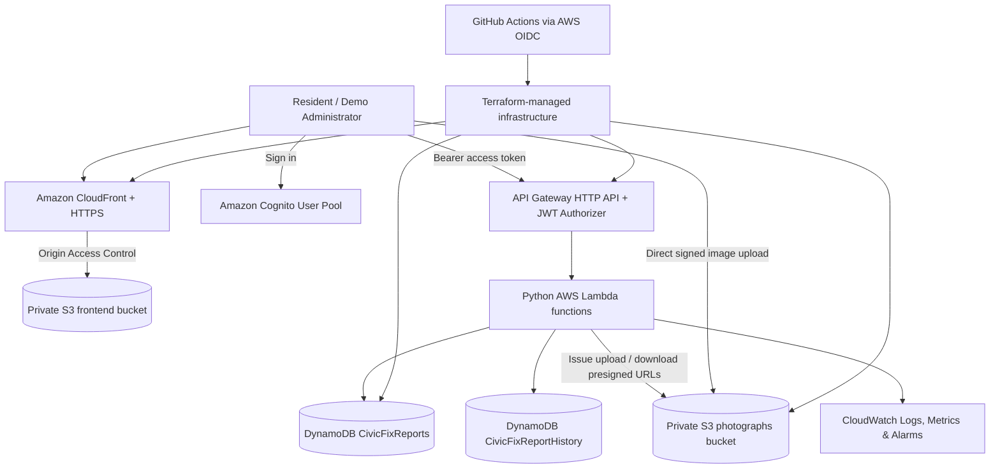

# CivicFix — AWS Solution Architecture

**Version:** 1.0 (design proposal)  
**Date:** 2026-11-16  
**Status:** Draft; resources not yet deployed

## 1. Objective

Deploy a secure, cost-conscious civic issue reporting MVP for Niagara Region as a portfolio demonstration. Residents can authenticate, upload an optional photograph, submit and track reports. Demo administrators can moderate and update reports. Public map data is restricted to approved, privacy-safe information. No official municipal integration is implied.

## 2. Architecture diagram

The diagram is logical, not a network topology. The browser directly uploads photographs using short-lived presigned URLs. JWT validation at API Gateway does not replace business authorization in Lambda.

## 3. Core technology choices

| Concern | Service / technology | Rationale |
|---|---|---|
| Frontend | Next.js static export, S3, CloudFront | Managed static delivery with no always-on web server |
| Authentication | Cognito user pool | Hosted identity lifecycle and token issuance |
| HTTP API | API Gateway HTTP API | Managed routing, JWT verification, throttling |
| Backend | Python AWS Lambda | Scale-to-demand business logic |
| Data | DynamoDB | Key-driven report queries, managed availability |
| Photos | Private S3 bucket | Durable object storage, direct browser upload |
| Monitoring | CloudWatch | Logs, error and latency alarms |
| Infrastructure | Terraform | Repeatable provisioning |
| Delivery | GitHub Actions and AWS OIDC | Automated pipeline without static access keys |

## 4. Frontend and routing constraints

Use `output: 'export'` in Next.js. Do not use server actions, runtime Next.js route handlers, server-side session cookies, or request-time SSR. Client components call the AWS HTTP API. Use static paths such as `/reports/view?id=...` instead of runtime-only App Router `[id]` routes for unknown IDs. Static export also requires explicit support for image handling rather than default server-side Next image optimization.

CloudFront uses an S3 REST origin protected with Origin Access Control (OAC), not the S3 website endpoint. Keep S3 Block Public Access enabled. Configure HTTPS and correct file-path behavior for generated static assets.

## 5. Request paths

### Authentication
1. Resident signs in through Cognito.
2. Frontend obtains a Cognito access token.
3. Protected API requests send `Authorization: Bearer <token>`.
4. API Gateway JWT authorizer validates the token.
5. Lambda checks identity, resource ownership and Cognito admin group membership as appropriate.

### Report with optional photo
1. Authenticated resident requests an upload authorization from `/uploads/presign`.
2. Lambda validates file type and allowed size, creates a scoped short-lived S3 key and upload authorization.
3. Browser uploads image directly to private S3.
4. Resident submits category, description, location and photo key to `/reports`.
5. Lambda validates input, ownership of photo key, and creates the report and initial status-history record with a DynamoDB transaction.
6. Backend returns `201 Created`, report ID and current status.

### Moderation and public map
1. New reports start as `SUBMITTED`, with `publicVisible=false`.
2. An authorized demo admin reviews a report and explicitly approves public visibility.
3. Published data omits user identity, raw sensitive coordinates and private photo access.
4. Public map queries retrieve approved reports only, bounded by geographic area and result limit.
5. Status changes record actor, time and reason in immutable history.

## 6. Data access and consistency

Two tables: `CivicFixReports` and `CivicFixReportHistory`. Use the access patterns and GSI definitions in `docs/database-design.md`. Maintain current report state and history using DynamoDB `TransactWriteItems` with version-based optimistic concurrency. GSIs are eventually consistent; direct base-table reads can be strongly consistent if required. Avoid table scans in request paths. Map results are bounded and approximate.

**Public map index caveat:** A GSI populated directly with unmoderated records could expose those records if public Lambda queries are incorrectly filtered. Use a sparse public-only GSI attribute or a dedicated public projection, and verify that the public handler cannot query private fields. Update the design document accordingly before implementation.

## 7. Networking / VPC decision

**No customer-managed VPC for MVP Lambda.** No service depends on resources inside a private VPC. Lambda can invoke DynamoDB and S3 from its default networking environment with IAM-controlled access. Introducing subnets, NAT gateways and endpoints creates cost and operating burden without a current requirement.

Revisit only if adding private relational databases, private networks or controlled egress. This demonstrates explicit trade-off reasoning rather than unnecessary infrastructure.

## 8. Security controls

- Cognito-issued access tokens, JWT authorizer for protected routes, and server-side authorization checks.
- No user-selectable admin role. Administrator membership is provisioned separately.
- Per-function IAM roles, restricted to required table actions, indexes and S3 prefixes.
- Backend validation for categories, length, coordinates, file format and maximum size.
- Upload tokens limited by expiration, key prefix and content constraints; verify uploaded object metadata before accepting a report. Consider S3 presigned POST policies for enforcement and delete abandoned uploads with lifecycle rules.
- Keep photo bucket and frontend origin bucket private and encrypted. Public views provide only reviewed media or time-limited controlled access.
- Configure API CORS with the deployed web origin; CORS is **not** an authorization boundary.
- Do not log JWTs, sensitive personal information, full image URLs or raw personal location data.
- Rate-limiting, CloudWatch alarms, and reasonable API quotas.
- Clearly label portfolio demonstration and avoid claiming official issue dispatch.

## 9. Reliability and recovery

- Assume Lambda retries or duplicate requests can occur; use idempotency where operations could create duplicates.
- Conditional writes and transactions prevent invalid state transitions and partial audit recording.
- CloudWatch alarms for API 5xx, Lambda errors/throttles and elevated duration.
- Configure log retention and structured request IDs for troubleshooting.
- Assess DynamoDB PITR for persistent environments; restoration creates a new table and needs a tested cutover runbook.
- S3 versioning is optional for uploaded objects; lifecycle controls and retention requirements must be explicitly defined.
- No multi-region failover for MVP; document this as a trade-off.

## 10. Performance and scale

Initial test objectives (not claimed measurements): p95 API response below 500 ms for read requests under a specified small workload; successful report submissions >=99% excluding client/network failures. Record test sample sizes, workload, cold starts, throttling, capacity and failure cases. Limit search/map area and paginate lists using opaque cursors.

## 11. Cost management

Use AWS Budgets alerting before deployment. Initial cost drivers: CloudFront requests and egress, API Gateway requests, Lambda invocations and duration, DynamoDB on-demand reads/writes and indexes, DynamoDB PITR if enabled, S3 storage/requests, CloudWatch logs and any Cognito usage. There is no NAT gateway or managed database server in the MVP. Do not assume all services are free; prepare a region-specific pricing estimate with traffic assumptions in `docs/cost-analysis.md` before deployment.

## 12. Environments and deployment

- `dev`: development with synthetic data, small budgets and log retention.
- `prod-demo`: deploy only after core tests pass, and only if ongoing operating costs are acceptable.
- Separate Terraform state per environment in a securely configured S3 backend with state locking and restricted access.
- GitHub Actions uses AWS OIDC and tightly scoped trust conditions for branches/environment.
- CI runs linting, unit tests, Terraform formatting/validation and security checks; deployment requires appropriate branch/environment protections.
- Never commit credentials, tokens or Terraform state to Git.

## 13. Architecture decision records

See `docs/architecture-decisions/001-serverless.md`, `002-no-vpc.md`, and `003-static-frontend.md`.

## 14. Open questions / follow-ups

1. Confirm chosen AWS Region and constraints regarding actual user data residency.
2. Finalize public-only geospatial index projection and moderation workflow.
3. Choose exact CORS origins and frontend route fallback behavior.
4. Determine photo moderation workflow, content retention and abandoned-upload cleanup.
5. Estimate monthly AWS cost for stated usage levels before first Terraform apply.

## 15. References

- AWS API Gateway HTTP API JWT authorizers: https://docs.aws.amazon.com/apigateway/latest/developerguide/http-api-jwt-authorizer.html
- AWS Lambda VPC connections: https://docs.aws.amazon.com/lambda/latest/dg/configuration-vpc.html
- CloudFront private S3 origins: https://docs.aws.amazon.com/AmazonCloudFront/latest/DeveloperGuide/private-content-restricting-access-to-s3.html
- DynamoDB PITR: https://docs.aws.amazon.com/amazondynamodb/latest/developerguide/Point-in-time-recovery.html
- Next.js static export: https://nextjs.org/docs/app/guides/static-exports
